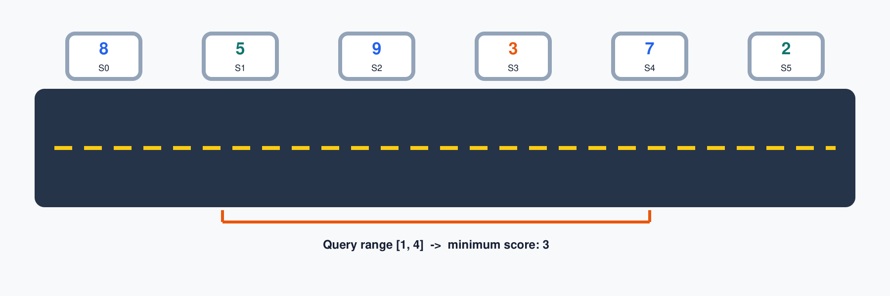
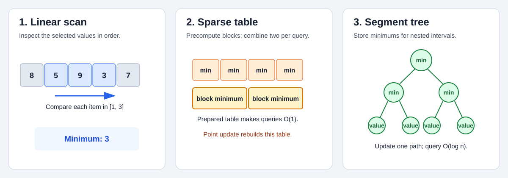
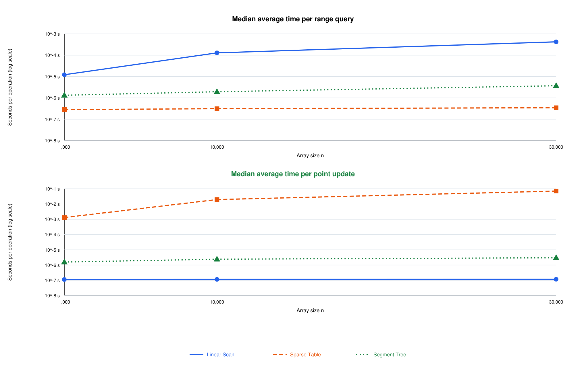
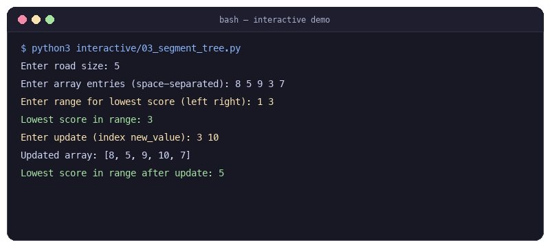

# Range Minimum Query with Point Updates

## Case Study No. 02 — Segment Trees and Sparse Tables

This project investigates how to answer range minimum queries on an array while also allowing individual values to change. It implements three approaches, checks their correctness, measures their performance, and recommends an approach for a changing-data workload.

## Problem

Given a non-empty array of scores, support two operations:

1. **Range minimum query:** For indexes `left` and `right`, return the smallest value in the inclusive range `values[left:right + 1]`.
2. **Point update:** Replace the value at one index.

For example, for `[8, 5, 9, 3, 7]`, the minimum over indexes `1` through `3` is `3`. If index `3` is later updated from `3` to `10`, the query result for that range becomes `5`.

The implementations use zero-based indexing. A valid query must satisfy `0 <= left <= right < n`; a valid update index must satisfy `0 <= index < n`. Empty arrays and invalid indexes are rejected with exceptions.



## Approaches



### Linear scan

The linear scan starts at the left endpoint and checks every value through the right endpoint, keeping the smallest value seen so far. A point update simply replaces the array entry.

- **Build:** `O(n)`, including the input copy.
- **Query:** `O(k)` for a range of length `k`; worst case `O(n)`.
- **Point update:** `O(1)`.
- **Space:** `O(n)` for the copied array.
- **Strength:** straightforward to implement and use as a reference for checking other algorithms.
- **Limitation:** repeated or broad queries require examining many values each time.

### Sparse table

The sparse table precomputes minimums for intervals with lengths that are powers of two. To answer a query, it looks up two precomputed intervals that cover the requested range and returns the smaller minimum. The intervals can overlap because taking a minimum is unaffected by seeing the same value twice.

- **Build:** `O(n log n)`.
- **Query:** `O(1)`.
- **Point update in this project:** `O(n log n)`, because the table is rebuilt after an update.
- **Space:** `O(n log n)`.
- **Strength:** very fast range queries when the array is static.
- **Limitation:** this implementation’s rebuild-on-update strategy is costly for frequently changing data.

The update cost stated here is specific to the implementation in this project. Sparse tables are generally best suited to data that does not change.

### Segment tree

A segment tree stores the minimum for a hierarchy of array intervals. A range query combines the stored minimums for the parts that cover the requested interval. A point update changes one leaf and recalculates the minimums on the path back to the root.

- **Build:** `O(n)`.
- **Query:** `O(log n)`.
- **Point update:** `O(log n)`.
- **Space:** `O(n)`.
- **Strength:** supports both queries and point updates efficiently.
- **Limitation:** requires more indexing and tree logic than a linear scan.

## Complexity comparison

| Approach | Build | Range query | Point update | Auxiliary space | Typical use |
|---|---:|---:|---:|---:|---|
| Linear scan | `O(n)` | `O(n)` worst case | `O(1)` | `O(n)` | Small arrays or few queries |
| Sparse table | `O(n log n)` | `O(1)` | `O(n log n)` here | `O(n log n)` | Static data with many queries |
| Segment tree | `O(n)` | `O(log n)` | `O(log n)` | `O(n)` | Dynamic data with queries and updates |

These are asymptotic bounds: they describe how the work grows as the input gets larger. The best option also depends on how often queries and updates occur and how wide the queried ranges are.

## Benchmark

The benchmark compares build time, average query time, average update time, and approximate Python-traced memory. It uses deterministic integer arrays of sizes `1,000`, `10,000`, and `30,000`.

For each array size, all three approaches receive the same input values, query ranges, and update sequence. The query workload mixes short, medium, and broad ranges. The script checks answers against direct calculations before it reports timings. It takes the median of five timing runs; query timing also batches three passes through the query set.

Measurements are from Python 3.9.6 on macOS arm64. Results can vary with hardware, system load, and Python version, so they should be treated as evidence for this workload rather than fixed performance guarantees.



### Recorded results

Times are per operation. `µs` means microseconds and `ms` means milliseconds. Memory is the approximate peak Python-traced allocation during structure construction, excluding the existing input array and interpreter baseline.

| Approach | Array size | Build (s) | Query avg | Update avg | Peak build memory |
|---|---:|---:|---:|---:|---:|
| Linear scan | 1,000 | 0.000000916 | 12.163 µs | 0.112 µs | 8.0 KiB |
| Sparse table | 1,000 | 0.00131271 | 0.283 µs | 1.305 ms | 101.9 KiB |
| Segment tree | 1,000 | 0.000197625 | 1.329 µs | 1.571 µs | 24.2 KiB |
| Linear scan | 10,000 | 0.000013416 | 128.625 µs | 0.115 µs | 78.3 KiB |
| Sparse table | 10,000 | 0.0185985 | 0.312 µs | 19.660 ms | 1,328.5 KiB |
| Segment tree | 10,000 | 0.00356742 | 1.943 µs | 2.415 µs | 334.5 KiB |
| Linear scan | 30,000 | 0.000032625 | 422.677 µs | 0.117 µs | 234.5 KiB |
| Sparse table | 30,000 | 0.0623089 | 0.345 µs | 70.728 ms | 4,219.1 KiB |
| Segment tree | 30,000 | 0.00681229 | 3.711 µs | 2.996 µs | 746.7 KiB |

The full-precision values are in [`results/benchmark_results.csv`](results/benchmark_results.csv).

### Interpretation

- The sparse table has the fastest measured queries at every tested size, consistent with its `O(1)` query complexity.
- Sparse-table update time grows sharply because this implementation rebuilds the full table after each change.
- Linear-scan query time increases as the arrays and queried ranges grow, since each query examines its range.
- Segment-tree query time is slightly higher than sparse-table query time, but segment-tree updates remain fast.
- The sparse table uses more memory than the segment tree in these tests, consistent with their `O(n log n)` and `O(n)` space requirements.

### Recommendation

For the case study’s changing road-score scenario, the **segment tree is the recommended primary approach**. It supports both range queries and point updates efficiently while using `O(n)` space.

Choose a sparse table instead when the data is static and query speed is the priority. Choose a linear scan for very small arrays, very few queries, or as a simple correctness reference.

## Correctness testing

The test suite uses Python’s built-in `unittest` framework and exercises all three implementations. It covers:

- Hand-worked expected answers, full-array ranges, single-element ranges, and boundary ranges.
- Updates at the first and last indexes, including updates that change the minimum.
- One-element and non-power-of-two array lengths.
- Ascending, descending, duplicate, and negative values.
- Deterministic mixed query/update sequences checked against a plain-list reference.
- Empty input, invalid query ranges, out-of-bounds update indexes, and preservation of the caller’s input array.

The benchmark also checks each generated query against a direct minimum before recording performance.

## Running the project

Python 3.9 or later is required. The implementations, tests, and benchmark use only the Python standard library.

Run all correctness tests from the project root:

```bash
python3 -m unittest discover -s tests -v
```

Run the benchmark and refresh its CSV and graph:

```bash
python3 tools/benchmark.py
```

### Interactive User-Input Mode

Run any of the three approaches interactively with custom road sizes, scores, query ranges, and point updates:

```bash
# Linear scan
python3 interactive/01_linear_scan.py

# Sparse table
python3 interactive/02_sparse_table.py

# Segment tree (Recommended)
python3 interactive/03_segment_tree.py
```



The ready-to-view presentation is available as [PDF](presentation/range_minimum_presentation.pdf).

## Project structure

```text
src/             Three standard RMQ implementations
interactive/     Interactive CLI versions with live user input
tests/           Correctness and edge-case tests
tools/           Benchmark script
results/         Benchmark data, screenshots, and visualizations
docs/            Report in DOCX and PDF
presentation/    Presentation slide deck (PDF)
```

## Deliverables

- [Full report (PDF)](docs/report.pdf)
- [Full report (DOCX)](docs/report.docx)
- [Presentation (PDF)](presentation/range_minimum_presentation.pdf)
- [Benchmark data (CSV)](results/benchmark_results.csv)
- [Benchmark graph (PNG)](results/benchmark_chart.png)
- [Interactive CLI screenshot (PNG)](results/interactive_demo.png)

## Contributors

Daksh Srivastava  
Prathamesh More  
Yuvraj Mishra  
Biswajeet Rout  
Sumit Shingole
