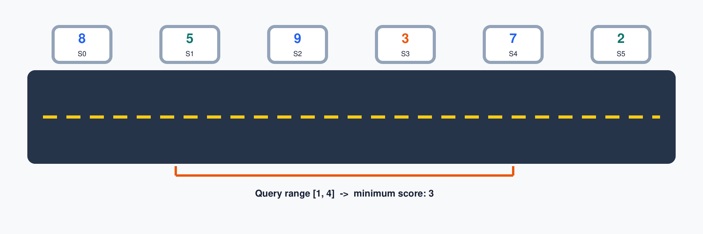
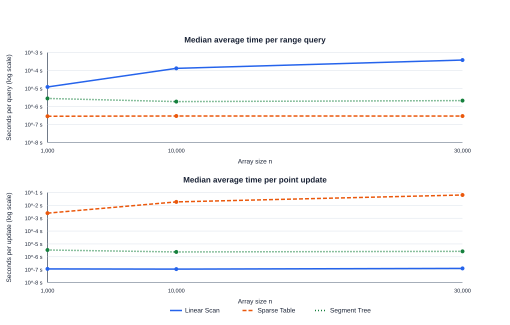

# Range Minimum Query with Point Updates

## Algorithm Design, Correctness Tests, and Benchmark Report

**Case Study No. 02 — Segment Trees & Sparse Tables**

**Prepared:** November 9, 2026

**Purpose:** Compare three range-minimum-query approaches and recommend a suitable data structure for a workload that may include point updates.

**Prepared by:** Daksh Srivastava, Prathamesh More, Yuvraj Mishra, Biswajeet Rout, Sumit Shingole



---

## 1. Executive summary

A road-quality monitor stores one score for each road segment. It must answer questions such as “what is the lowest score from segment 120 through segment 450?” A new inspection can also change the score at one position. This is the **range minimum query (RMQ) with point updates** problem.

Three approaches were implemented and compared:

1. **Linear scan:** inspect every value in the requested range.
2. **Sparse table:** preprocess answers for power-of-two intervals; answer each query using two precomputed intervals. A point update rebuilds the table.
3. **Segment tree:** store interval minima in a tree so both queries and point updates can be handled without rebuilding everything.

All three implementations passed the included correctness tests. The benchmark used the same deterministic arrays and operations for each approach at each size. In this run, sparse-table queries were the fastest, but its rebuild-on-update cost and memory use were much higher. Linear scanning’s query time increased as ranges and arrays grew. The segment tree provided fast queries and fast updates with substantially less memory than the sparse table.

**Recommendation:** use the segment tree for a changing road-score system that requires both range queries and point updates. Use the sparse table only if the scores are effectively static and query speed is the overriding priority.

## 2. Problem definition and design contract

### Input and output

- **Input:** a non-empty, zero-indexed array of comparable numeric scores, and an operation.
- **Range query:** two integer indexes `left` and `right`, inclusive.
- **Query output:** the smallest value in `values[left:right + 1]`.
- **Point update:** an integer index and a replacement score. It changes exactly that position.
- **Update output:** no value is returned; the data structure’s stored state changes.

### Assumptions and constraints

- Indexing is zero-based, and query ranges are inclusive.
- The array must contain at least one value.
- A valid query must satisfy `0 <= left <= right < n`.
- A valid update index must satisfy `0 <= index < n`.
- Invalid ranges raise `ValueError`; invalid update indexes raise `IndexError`.
- Values can be negative, repeated, or positive. The benchmark uses integer scores.
- Each implementation copies the input list, so later changes to the caller’s list do not silently alter the structure.
- A sparse-table point update rebuilds its preprocessing table. This is intentionally simple and correct, but expensive; it is not presented as a dynamic sparse-table algorithm.
- Disconnected components and unreachable states do not apply: the input is a one-dimensional array, not a graph.

### Success criteria

1. Every valid query returns the same minimum as a direct Python `min` over the requested slice.
2. Updates change future answers and do not change unrelated positions.
3. Boundary, invalid-input, and non-power-of-two array cases behave consistently.
4. The three approaches are benchmarked on identical data and operation sequences.
5. The final recommendation follows the measured and theoretical trade-offs rather than query speed alone.

## 3. Algorithms and correctness reasoning

### 3.1 Linear scan

**Pseudocode**

```text
QUERY(left, right):
    validate 0 <= left <= right < n
    smallest = values[left]
    for i from left + 1 through right:
        if values[i] < smallest:
            smallest = values[i]
    return smallest

UPDATE(index, value):
    validate 0 <= index < n
    values[index] = value
```

**Why it is correct:** after the loop has visited through index `i`, `smallest` is the minimum of all visited values from `left` through `i`. The loop visits every element in the requested inclusive interval, so the final value is its minimum. An update directly replaces one stored element.

**Complexity:** build `O(n)` including the input copy; query `O(k)` for a range of length `k` (worst case `O(n)`); point update `O(1)`. The copied input array uses `O(n)` storage, while a query uses only `O(1)` additional workspace.

### 3.2 Sparse table

**Pseudocode**

```text
BUILD(values):
    table[0] = values
    for each power k >= 1:
        for each start where an interval of length 2^k fits:
            table[k][start] =
                min(table[k-1][start],
                    table[k-1][start + 2^(k-1)])

QUERY(left, right):
    validate 0 <= left <= right < n
    length = right - left + 1
    k = floor(log2(length))
    block = 2^k
    return min(table[k][left],
               table[k][right - block + 1])

UPDATE(index, value):
    validate 0 <= index < n
    values[index] = value
    BUILD(values)
```

**Why it is correct:** each table entry stores the minimum of its represented interval. The query chooses two intervals of length `2^k` that together cover the requested range; they may overlap. Overlap is safe for the `min` operation because taking the minimum of a value more than once cannot change the result. Their union covers the full query, so the smaller of the two stored minima is the requested minimum. Rebuilding after an update restores the table invariant.

**Complexity:** build `O(n log n)`; query `O(1)`; point update `O(n log n)` for this implementation because it rebuilds; auxiliary storage `O(n log n)`.

### 3.3 Segment tree

**Pseudocode**

```text
BUILD(values):
    place values in the tree leaves
    fill each parent with min(left_child, right_child)

QUERY(left, right):
    validate 0 <= left <= right < n
    use the iterative tree walk to select disjoint nodes
        that exactly cover [left, right]
    return the minimum stored in those nodes

UPDATE(index, value):
    validate 0 <= index < n
    replace the corresponding leaf
    recompute each ancestor as min(left_child, right_child)
```

The implementation pads the leaf area to the next power of two with positive infinity. Padding does not affect a real query because query indexes are checked against the original array length.

**Why it is correct:** every internal node stores the minimum of its child intervals. The iterative query selects nodes whose covered intervals are disjoint and whose union is exactly the requested inclusive interval. Taking the minimum of those node values therefore gives the range minimum. For an update, only the updated leaf and its ancestors can have changed interval minima; recomputing that path restores the invariant throughout the tree.

**Complexity:** build `O(n)`; query `O(log n)`; point update `O(log n)`; auxiliary storage `O(n)`.

## 4. Correctness testing

The test suite is `tests/test_rmq.py`, using only Python’s standard `unittest` library. Run it from the project root:

```text
python3 -m unittest discover -s tests -v
```

The suite checks all three implementations against expected results. It covers:

- Hand-worked answers, full-array ranges, single-element ranges, and ranges touching either boundary.
- Updates at index `0` and the final index, including changes to and away from the current minimum.
- Length-one and non-power-of-two arrays, ascending and descending inputs, duplicate values, and negative values.
- A deterministic sequence of 100 mixed random queries and updates for each implementation, checked against a plain list.
- Invalid ranges, out-of-bounds updates, empty input, and input-list preservation.

**Validation result:** all 7 test methods passed for all three approaches (`Ran 7 tests ... OK`). The benchmark additionally checks every timed query against the direct minimum and checks the updated positions before it reports timings. Thus timing output is not produced if its workload’s correctness check fails.

## 5. Benchmark method

Run the benchmark from the project root:

```text
python3 tools/benchmark.py
```

The script uses Python’s standard library only. It reports the runtime environment, writes machine-readable `results/benchmark_results.csv`, and creates the labelled graph `results/benchmark_chart.svg`.

### Dataset and workload

| Array size (`n`) | Queries per approach | Updates per approach |
|---:|---:|---:|
| 1,000 | 300 | 20 |
| 10,000 | 300 | 20 |
| 30,000 | 200 | 10 |

Values are generated deterministically as integers in `[-100,000, 100,000]`. A fixed seed makes each size reproducible. For each array size, every approach receives the same query ranges and point updates. Query ranges deliberately include a mix of short ranges (about 1–5% of the array), medium ranges (about 25–50%), and broad ranges (about 50–100%). This avoids measuring only tiny intervals, which would understate the linear scan’s work. Update positions and replacement values are identical across approaches.

Build time is the median of five measurements. Average query time is measured over three passes through the same query set; the reported value is the median per-query time from five runs. Average update time is similarly measured and reported as the median per-update time from five runs. Structure construction is outside the query and update timers. Peak build allocation is measured separately with `tracemalloc`; it is approximate Python-traced memory for the structure build and excludes the already-existing input array and interpreter baseline.

**Environment:** the local runtime and system version were verified as Python 3.9.6, macOS 27.0.1 (build 26A434), arm64. These are the environment details recorded for the benchmark. Timings are wall-clock measurements and can vary with hardware, background load, and Python version. They are evidence for this workload, not universal constants.

## 6. Measured results

The measurements below reproduce the CSV field values exactly; times are seconds and peak build allocation is in bytes as reported by `tracemalloc`. The allocation measure is approximate Python-traced memory, not process resident memory.

#### Array size 1,000 (300 queries, 20 updates)

| Approach | Build (s) | Avg query (s) | Avg update (s) | Peak build (bytes) |
|---|---:|---:|---:|---:|
| Linear Scan | 9.580000000022904e-07 | 1.2189027777777775e-05 | 1.1455000000007432e-07 | 8144 |
| Sparse Table | 0.0013421249999999996 | 2.874999999999714e-07 | 0.0024850416499999986 | 104376 |
| Segment Tree | 0.0001979590000000253 | 2.7920377777777993e-06 | 3.3770500000002144e-06 | 24764 |

#### Array size 10,000 (300 queries, 20 updates)

| Approach | Build (s) | Avg query (s) | Avg update (s) | Peak build (bytes) |
|---|---:|---:|---:|---:|
| Linear Scan | 2.449999999998287e-05 | 0.00013146314777777785 | 1.1039999999740147e-07 | 80144 |
| Sparse Table | 0.01919770800000009 | 2.968988888888783e-07 | 0.018523210450000004 | 1360376 |
| Segment Tree | 0.0028473749999999853 | 1.869398888888855e-06 | 2.3729000000027865e-06 | 342524 |

#### Array size 30,000 (200 queries, 10 updates)

| Approach | Build (s) | Avg query (s) | Avg update (s) | Peak build (bytes) |
|---|---:|---:|---:|---:|
| Linear Scan | 3.191700000026998e-05 | 0.0003804334716666672 | 1.2499999995085887e-07 | 240144 |
| Sparse Table | 0.0634006660000006 | 2.944450000012348e-07 | 0.06376233330000006 | 4320376 |
| Segment Tree | 0.006247708000000074 | 2.133193333332765e-06 | 2.6541000000435135e-06 | 764668 |



The complete unrounded machine-readable results are in [benchmark_results.csv](../results/benchmark_results.csv). Regenerate the data and graphs with [benchmark.py](../tools/benchmark.py).

## 7. Interpretation, comparison, and recommendation

### Query performance

The sparse table had the smallest measured query time at every tested size, consistent with its `O(1)` query complexity. Its query procedure needs only two precomputed table lookups and one minimum operation.

The segment tree’s query time increases with the logarithmic tree height, consistent with `O(log n)`, and remains low for this tested workload.

The linear scan’s average query time grows with the number of values inspected. A short-range workload or very small array can make it sufficient, while broad ranges and repeated queries require more scanning.

### Update performance

The linear scan updates one array element directly, so its update work is constant. Sparse-table updates are substantially more expensive in the recorded measurements because this implementation rebuilds the full table after each change. Segment-tree updates recalculate only one path from a leaf to the root.

### Memory and total workload trade-off

The sparse table’s query advantage comes with a memory and update cost. The recorded traced build allocation is greater for the sparse table than for the segment tree at every tested size, consistent with their `O(n log n)` and `O(n)` space requirements.

The choice depends on the workload:

- **Sparse table:** preferable for static data with many range queries, when query speed is the priority and updates are absent or rare.
- **Linear scan:** sufficient for small arrays or very few queries, where its simplicity can outweigh the cost of scanning each range.
- **Segment tree:** preferable when frequent point updates and range queries are both required, because each takes `O(log n)` time without rebuilding the complete structure.

A segment tree is less suitable for static data with many queries when a sparse table’s `O(1)` query time is more valuable, and it can be unnecessary overhead for a tiny array or a handful of operations that a linear scan handles simply.

### Correctness, edge cases, and implementation effort

All three implementations use the same zero-based inclusive range contract and reject invalid query ranges. They also reject an empty initial array and out-of-range update indexes. The segment tree’s padding covers non-power-of-two lengths without exposing padded positions to valid queries. The sparse table’s overlapping query blocks are safe specifically because `min` is idempotent. The tests exercise these behaviors and compare randomized operations to a direct-list reference.

Implementation effort follows the structures’ complexity: the linear scan is the simplest to implement and inspect; the sparse table needs logarithm and interval preprocessing, and its update path is deliberately a full rebuild; the segment tree needs careful parent/child indexing and boundary handling, but then supports both operations without global rebuilding. This is a practical cost alongside runtime and memory: the simple scan is valuable as a correctness oracle even when it is not the fastest production choice.

### Recommendation for the road-quality monitor

The scenario includes inspection updates as well as range queries. The **segment tree is the recommended primary structure** because both operations remain efficient as the array grows, and it avoids the sparse table’s expensive full rebuild and higher memory use. Keep the linear scan as a simple correctness reference. Choose the sparse table only for a separately defined static-data workload where updates are absent or exceptionally rare.

## 8. Limitations and conclusion

This benchmark is controlled and reproducible, but it does not represent every real deployment. It tests three array sizes, integer scores, one deterministic random dataset per size, and a defined mix of interval lengths. Other hardware, Python implementations, score types, query distributions, or update/query ratios can change the measured constants. Python timer overhead is also relevant to very small operations; the script reduces that effect by batching queries and using medians, but these results should not be read as precise production latency guarantees. Traced Python allocation is an approximation and not a substitute for operating-system resident-memory profiling.

The theoretical behavior and the measured evidence point to the same workload-dependent conclusion: linear scan prioritizes simplicity, sparse table prioritizes static-query speed, and segment tree balances dynamic queries and updates. For range minimum with point updates, the segment tree is the best-supported recommendation.

## Submission files

- [src/01_linear_scan.py](../src/01_linear_scan.py) — linear-scan implementation.
- [src/02_sparse_table.py](../src/02_sparse_table.py) — sparse-table implementation with rebuild-on-update.
- [src/03_segment_tree.py](../src/03_segment_tree.py) — segment-tree implementation.
- [tests/test_rmq.py](../tests/test_rmq.py) — correctness and edge-case tests.
- [tools/benchmark.py](../tools/benchmark.py) — reproducible benchmark and correctness checks.
- [results/benchmark_results.csv](../results/benchmark_results.csv) — raw benchmark output.
- [results/benchmark_chart.svg](../results/benchmark_chart.svg) — query/update comparison graph generated by the benchmark.
- [presentation/slides_outline.md](../presentation/slides_outline.md) — presentation outline.
- [presentation/index.html](../presentation/index.html) — browser-based presentation.
- [presentation/range_minimum_presentation.pdf](../presentation/range_minimum_presentation.pdf) — presentation PDF.
- [README.md](../README.md) — run instructions.
- [docs/report.md](./report.md), [docs/report.docx](./report.docx), and [docs/report.pdf](./report.pdf) — this report in source and submission formats.
